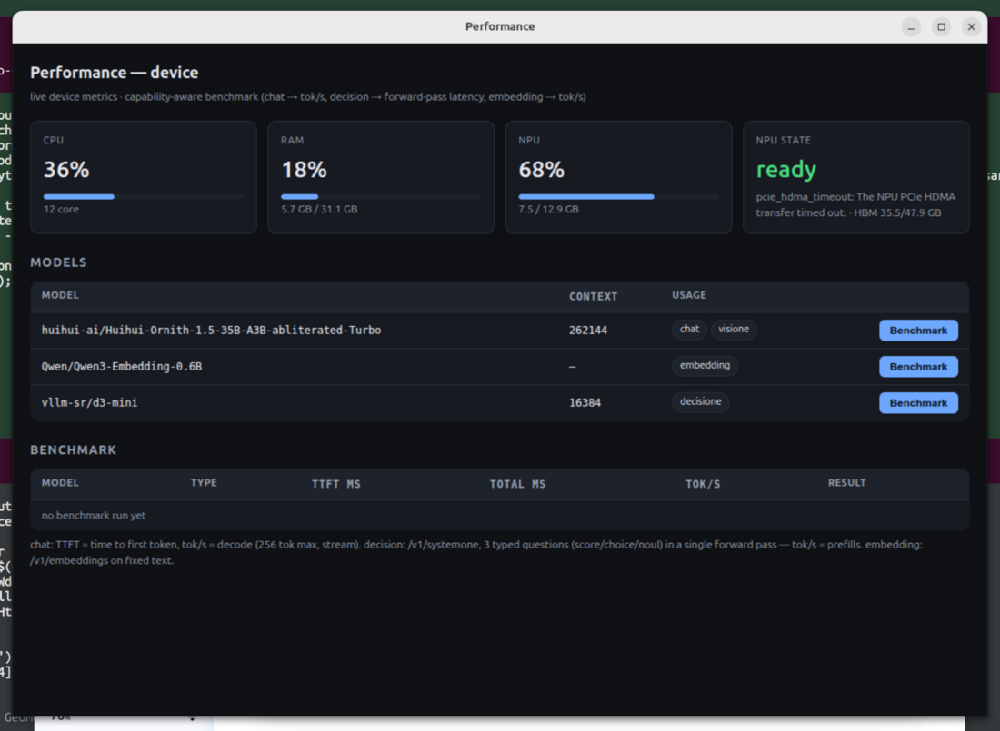
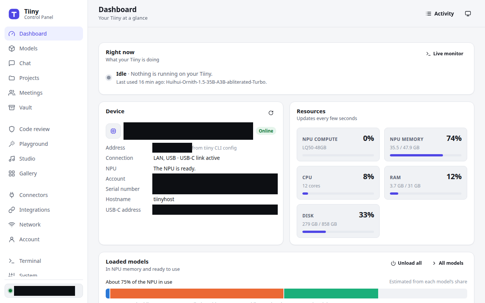
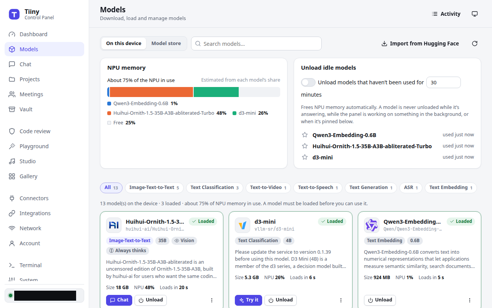

# tiinyos-linux



Run the **Tiiny Pocket** desktop client (TiinyOS) on Linux and add two features
the official macOS/Windows app does not ship:

- **Performance** — a capability-aware benchmark of the Pocket device:
  one row per run (model, mode, tokens/s, TTFT, VRAM headroom, flags),
  CSV export, history kept locally.
- **Control Panel** — the community
  [Tiiny Control Panel](https://github.com/0xStian/tiiny-control-panel) (MIT)
  embedded in the app window from the tray, with automatic sign-in.


Everything is added by patching the Electron bundle locally. The official
bundle is downloaded by you from Tiiny's public CDN — this repository ships no
proprietary binaries. Every change is reversible (`install.sh --uninstall`).

**Not affiliated with Tiiny AI Lab Inc.** TiinyOS and the Tiiny Pocket are
trademarks of their owner. This is a community port for personal use.

## Screenshots

| Dashboard (community Control Panel) | Model store | Performance |
|---|---|---|
|  |  |  |

## Known issues & prevention

Known failure modes of the vendor stack, with what stops them. The first and
third are **prevented by the install itself**; the others are operational habits.

| Issue | What you'd see | Prevention |
|---|---|---|
| `pcsvr` thread leak in the official shim (~600 threads/h) | fans at 100% after ~a day, whole system slow | **built-in**: `tools/pcsvr-watchdog.sh` systemd timer restarts the shim before the threshold ([RCA](docs/vendor-thread-leak.md)) |
| Another client holds the device session | `/connect probe failed` in the log, app opens but does nothing | run **one** app instance per device (the vendor protocol has no multi-client session) |
| File-descriptor exhaustion (`EMFILE`) in the shim on long uptime | random network errors, or the shim alive but port 60000 silent (device features stop) | **built-in**: the watchdog restarts the shim with `ulimit -n 65536` when the port goes silent; if you restart it manually, set the limit in the shell first |
| Device hostname resolution breaks when the device gets a new IP | login hangs, device "offline" | re-apply the `/etc/hosts` line after reconnecting the device on a new network ([network.md](docs/network.md)) |

Symptom-first fixes (with commands) in [docs/TROUBLESHOOTING.md](docs/TROUBLESHOOTING.md).

## Agent store on Linux

The store catalog is served by the device, and several desktop agents
(Tiiny Meeting, opencode, HermesAgent, OpenClaw) publish **only Windows and
macOS binaries** — the store has nothing to install them with on Linux. The web
apps (n8n, Open WebUI, Dify, SillyTavern, …) run on the device and are
unaffected. Full catalog, evidence and Linux workarounds:
[docs/agent-store.md](docs/agent-store.md).

## Requirements

- Linux x86_64, a Tiiny Pocket device connected over USB-C
- `curl`, `7z` (p7zip), `unzip`, `git`, Python ≥ 3.10, Node ≥ 18 (for `npx @electron/asar`)
- the device USB network reachable (`docs/network.md`) and the /etc/hosts entries from it

## Install

```bash
git clone https://github.com/3p4dm4/tiinyos-linux && cd tiinyos-linux
./build_clone.sh                 # downloads the official bundle + Electron
sudo nano /etc/hosts             # device name resolution (build_clone.sh prints the line)
./fetch_control_panel.sh         # community control panel -> ~/.local/share/...
./install.sh                     # feature pack + tray entries + desktop launchers
~/.local/tiinyos-clone/run.sh
```

Rollback: `./install.sh --uninstall` (restores the pristine bundle).

The official `pcsvr` shim has a thread leak (fans max out after a day or so);
`install.sh` ships a guard for it — enable the timer as instructed at the end
of the install ([details](docs/vendor-thread-leak.md)).
Troubleshooting: [docs/TROUBLESHOOTING.md](docs/TROUBLESHOOTING.md).
AI agents working on this repo: start from [AGENTS.md](AGENTS.md).

## Tested

The full chain above (build → install → launch → uninstall → pristine
restored and runnable) was verified end to end on Fedora 44 with a Tiiny
Pocket on 2026-11-17: see [`docs/TEST_REPORT.md`](docs/TEST_REPORT.md)
for the step-by-step evidence.

What this port covers: login, chat, model manager, the two extra features
(Performance, Control Panel). Pages of the official app not exercised by this
port may still have rough edges on Linux — open an issue with the log from
`~/.local/tiinyos-clone/logs/`.

## How it works

| piece | what it does |
|---|---|
| `build_clone.sh` | extracts `app.asar` from the official NSIS installer, pairs it with upstream Electron 37.4.0, writes `run.sh` |
| `install.sh` | unpacks the pristine `app.asar`, drops the feature files in, applies a marker-based patch to the minified main bundle, repacks with correct unpacked/integrity flags, verifies the header |
| `src/m3perf/` | benchmark engine (device probe, sampler, reporter) |
| `src/m3_cp.js` | control-panel supervisor inside the app (spawn-if-needed, single window, guided navigation) |
| `tools/patch_main.py` | the only edit to the minified bundle: tray menu + window injection (idempotent) |
| `tools/pcsvr-watchdog.sh` | guard for the vendor thread leak — systemd user timer, see `docs/vendor-thread-leak.md` |

The renderer pages of the bundle are separate files, so features are added as
new files plus one surgical patch — no rewrite of vendor code.

## Known limitations

- One app instance at a time per device: a second running copy logs
  `/connect probe failed` while the first holds the device session.
- `--no-sandbox` is currently required to run the bundle on Linux.
- Device hostname resolution via `/etc/hosts` is manual (per-network IP).
- The Control Panel terminal feature requires starting the panel with
  `--allow-commands` (opt-in, see its README).

## License

MIT (our code). The Tiiny Control Panel is MIT, (c) its authors. TiinyOS is
proprietary software by Tiiny AI Lab Inc., used under your own license; it is
not redistributed here.
